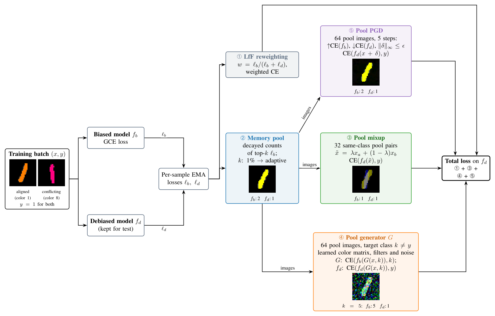

# PoolForge

PoolForge is a debiasing method that uses no bias labels during training. It extends
Learning from Failure (LfF, NeurIPS 2020) with:

- a **memory pool** of the training images that the biased model keeps failing on;
- three sources of extra training images built from that pool:
  - same-class **pool mixup**;
  - a learned **pool generator** whose edits are judged by the biased model;
  - **pool PGD**.

PoolForge is the model called *V11* in our development notes (run name `explore_ga_no_newton`).

This repository has the method, five baselines and all ablations in one code base. It also includes every trained
checkpoint, its training log and its test predictions, so every number in the report can be reproduced without
training.

**Report:** [report/report.pdf](report/report.pdf) covers method, datasets, baselines, setup, results, ablations,
case study, reproduction and conclusion.



## Results

Test accuracy on bias-conflicting images (%), averaged over (class, bias) groups. All models are trained from scratch
with the same code, backbone and selection rule.

**Seed 0, all methods:**

| Method | CMNIST | C-CIFAR10 | BFFHQ | Avg. |
|---|---|---|---|---|
| Vanilla | 32.3 | 8.3 | 52.6 | 31.1 |
| LfF | 73.3 | 39.2 | 64.2 | 58.9 |
| JTT | 55.3 | 14.7 | 50.2 | 40.1 |
| LC | 46.3 | **41.4** | 64.2 | 50.6 |
| LDD | 75.6 | 18.5 | 59.4 | 51.2 |
| **PoolForge** | **84.4** | 40.0 | **72.2** | **65.5** |

**Seeds 0, 1 and 2 (mean ± std):**

| Method | CMNIST | C-CIFAR10 | BFFHQ | Avg. |
|---|---|---|---|---|
| LfF | 70.6 ± 2.0 | 35.8 ± 3.8 | 62.3 ± 1.6 | 56.2 ± 2.1 |
| **PoolForge** | **83.2 ± 1.0** | **40.7 ± 0.8** | **71.2 ± 1.1** | **65.0 ± 0.8** |

The unbiased and worst-group tables, the bias ratios and the ablations are in [results/RESULTS.md](results/RESULTS.md).
BFFHQ has no bias-conflicting validation images, so every method selects its BFFHQ checkpoint on the test set.

## Reproduce

### 1. Install and download the data

```bash
pip install -r requirements.txt   # Python 3.10, PyTorch 2.5.1; a CUDA GPU for training, CPU is enough otherwise
python prepare_data.py            # downloads the DisEnt release (CMNIST, C-CIFAR10, BFFHQ) into data/
```

`prepare_data.py` downloads the dataset release of [DisEnt](https://github.com/kakaoenterprise/Learning-Debiased-Disentangled)
from Google Drive, unzips it into `data/` and caches every split as `data/cache/*.npz`. You can also place the unzipped
`cmnist/`, `cifar10c/` and `bffhq/` folders in `data/` yourself.

### 2. Reproduce every table from the shipped checkpoints (no training)

```bash
python results.py --device cpu    # evaluates all 66 checkpoints in runs/ -> results/RESULTS.md and results/tables/
python predict.py --device cpu    # test predictions of every checkpoint -> predictions/<exp>/<benchmark>/seed<k>.csv
python case_study.py --device cpu # case-study figures and statistics -> results/case_study/
bash report/build.sh              # rebuilds report/report.pdf from the files above
```

`results.py` loads each `best.pt`, predicts the test set and computes the metrics from scratch. For every checkpoint,
the bias-conflicting accuracy it computes equals the value logged during training (largest difference 0.0).
Remove `results/` and `predictions/` first if you want to recompute them.

Each prediction file has one row per test image: `index, file, label, bias, bias_conflicting, prediction, confidence`.
`file` is the image path inside `data/`.

To load a checkpoint yourself:

```python
import torch
from poolforge.data import BENCHMARKS, load_data, predict_logits
from poolforge.networks import network_for

ckpt = torch.load("runs/poolforge/cmnist_1pct/seed0/best.pt", map_location="cpu", weights_only=False)
model = network_for(ckpt["method"], ckpt["benchmark"], BENCHMARKS[ckpt["benchmark"]]["num_classes"])
model.load_state_dict(ckpt["model"])
test = load_data(ckpt["benchmark"], torch.device("cpu"))["test"]
pred = predict_logits(model, ckpt["benchmark"], test["x"]).argmax(1)
```

### 3. Retrain (optional)

```bash
python run.py --list --group all                                   # what is present
python run.py --exp poolforge --benchmark cmnist_1pct --seed 0 --gpus 0   # one run
python run.py --group all --gpus 0,1 --per_gpu 2                   # every run of the report
```

`run.py` skips any run whose folder already has `result.json`. To retrain a shipped run, move its folder away first,
for example `mv runs/poolforge/cmnist_1pct/seed0 runs_shipped/`. Groups: `baselines`, `ours`, `ablations`,
`case_study`; `--benchmark` and `--seed` narrow the selection.

Training uses deterministic cuDNN. The pool generator upsamples with `F.interpolate`, whose backward pass on the GPU
uses atomic additions, so a retrained PoolForge run matches the shipped one exactly until the generator starts (step
2000) and then drifts slightly. On the CPU the training code is fully deterministic and reproduces the logged
history of the original runs exactly. On CMNIST seed 0, two GPU retrains selected the same step as the shipped run and
scored 84.34 and 84.38 against 84.41. All five baselines are fully deterministic on the GPU (CMNIST retrains repeat
the shipped logs exactly).

Measured wall-clock time of the seed-0 runs (several runs shared each GPU, so these are upper bounds):

| Benchmark | LfF | PoolForge |
|---|---|---|
| CMNIST | 2 min | 28 min |
| C-CIFAR10 | 53 min | 3.9 h |
| BFFHQ | 46 min | 5.7 h |

### 4. Submission package

```bash
python make_submission.py         # submission.zip: code, predictions/ and runs/*/*/seed*/{best.pt,result.json,history.csv,train.log}
```

## Layout

```
poolforge/
  data.py            dataset loading, caching, augmentation
  networks.py        MLP (CMNIST), ResNet-20 (C-CIFAR10), ResNet-18 (BFFHQ), DisEnt network
  metrics.py         group accuracies: bias-conflicting, unbiased, worst-group
  trainer.py         training loop, evaluation, checkpoint selection, all hyperparameters
  methods/
    base.py          Vanilla (ERM)
    lff.py           LfF
    jtt.py           JTT
    lc.py            Logit Correction
    ldd.py           DisEnt / LDD
    poolforge.py     PoolForge: memory pool, pool mixup, pool generator, pool PGD
experiments.py       every experiment of the report (baselines, PoolForge, ablations, case study)
run.py               multi-GPU training launcher
results.py           evaluation of the checkpoints and result tables
predict.py           test predictions of the checkpoints
case_study.py        saved-image analysis, bias probe, best/worst test groups
make_submission.py   zip of code, checkpoints and predictions
prepare_data.py      dataset download
runs/                every trained run of the report (checkpoints, logs, histories)
predictions/         test predictions of every checkpoint
results/             tables, per-run metrics and case-study figures produced by the scripts above
report/              LaTeX source and PDF of the report
```

Each run folder, `runs/<experiment>/<benchmark>/seed<k>/`, contains:

- `best.pt`: the selected checkpoint of the debiased model;
- `history.csv`: all metrics at every evaluation step;
- `result.json`: the selected step and its test score;
- `train.log`: the full configuration and training progress.

`runs/case_study/` holds the images saved during a repeated PoolForge seed-0 run (`case_step*.pt`), used by
`case_study.py`.

## Experiments

| Experiment | Runs | Description |
|---|---|---|
| `vanilla`, `jtt`, `lc`, `ldd` | 3 benchmarks, seed 0 | baselines |
| `lff` | 3 benchmarks × 3 seeds, 6 other bias ratios | LfF baseline |
| `poolforge` | 3 benchmarks × 3 seeds, 6 other bias ratios | the method |
| `poolforge_no_reweight` | 3 benchmarks, seed 0 | without LfF reweighting |
| `poolforge_repeat` | 3 benchmarks, seed 0 | pool images repeated instead of mixed |
| `poolforge_no_gen` | 3 benchmarks, seed 0 | without pool generator |
| `poolforge_gen_color` | 3 benchmarks, seed 0 | color-only generator |
| `poolforge_gen_untargeted` | 3 benchmarks, seed 0 | untargeted generator |
| `poolforge_gen_batch` | 3 benchmarks, seed 0 | generator on batch images |
| `poolforge_no_pgd` | 3 benchmarks, seed 0 | without pool PGD |
| `poolforge_pgd_batch` | 3 benchmarks, seed 0 | PGD on batch images (BiasAdv) |
| `case_study` | 3 benchmarks, seed 0 | PoolForge run that saves intermediate images |

## Benchmarks

| Benchmark | Target | Bias | Bias ratios | Backbone |
|---|---|---|---|---|
| Colored MNIST | digit | digit color | 0.5, 1, 2, 5% | 3-layer MLP |
| Corrupted CIFAR-10 | object | corruption type | 0.5, 1, 2, 5% | ResNet-20 |
| BFFHQ | age | gender | 0.5% | ResNet-18 |

## Credits

PoolForge reuses or modifies parts of earlier methods:

- *Learning from Failure* (LfF, NeurIPS 2020): reweighting, unchanged.
- *mixup* (ICLR 2018): pool mixup.
- *Fighting Fire with Fire* (CDvG, ICML 2023): the idea behind the pool generator.
- *BiasAdv* (CVPR 2023): pool PGD.

The baselines are:

- *Just Train Twice* (JTT, ICML 2021);
- *Avoiding Spurious Correlations via Logit Correction* (LC, ICLR 2023);
- *Learning Debiased Representation via Disentangled Feature Augmentation* (DisEnt, NeurIPS 2021).

The datasets are the DisEnt release. Full references are in the report.
